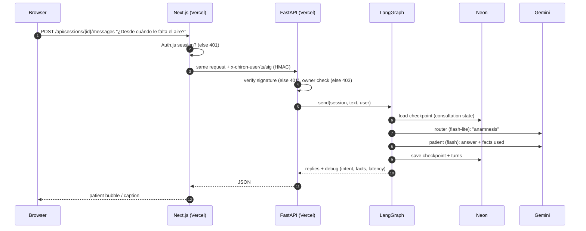
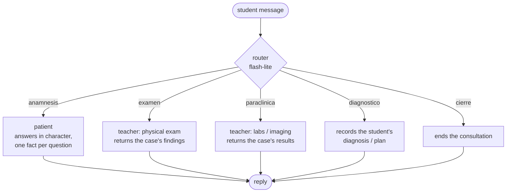
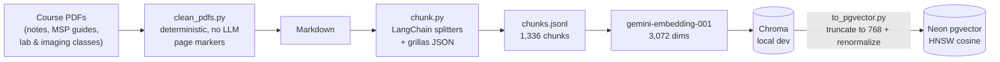
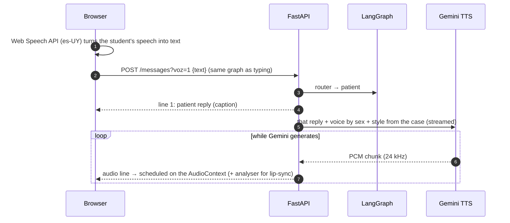

# Chiron — Architecture

How Chiron is built today, and why. Diagrams are Mermaid (rendered by GitHub).

## System overview

```mermaid
flowchart LR
    student([Student<br/>desktop or phone])

    subgraph vercel_web["Vercel · project chiron (web/)"]
        next["Next.js 16<br/>UI: chat + face to face<br/>Auth.js (Google sign-in)"]
        proxy["/api/* route handler<br/>checks session, signs identity"]
    end

    subgraph vercel_api["Vercel · project chiron-api (repo root)"]
        fastapi["FastAPI<br/>verifies signature"]
        graph["LangGraph agent<br/>router → patient / teacher"]
    end

    neon[("Neon Postgres · São Paulo<br/>consultations, turns,<br/>LangGraph checkpoints,<br/>pgvector RAG")]
    gemini["Gemini API<br/>3 keys, model fallback"]
    google["Google OAuth"]
    langsmith["LangSmith<br/>traces + evals"]

    student --> next
    next <--> google
    next --> proxy -- "HMAC-signed request" --> fastapi --> graph
    graph <--> neon
    graph --> gemini
    graph -. traces .-> langsmith
```

Two Vercel projects deploy from the same repo on every push to `main`: the frontend (root `web/`) and the backend (repo root). The browser never calls the backend directly.

## One student message, end to end



Typical latency: ~1–3 s per turn on warm instances. A cold start (instance scaled to zero) adds a few seconds; the UI shows "the server is waking up" after 3.5 s.

## The agent (LangGraph)



- **The case goes whole into the patient's prompt, without RAG.** A case is small, and full context is more reliable than retrieved fragments. RAG is for reference material (the feedback step will cite it).
- **The patient never sees the diagnosis.** Its prompt has the patient's facts only; exam findings and lab results live in the teacher nodes. Even a successful jailbreak can't reveal what the model was never given (defense in depth).
- **Structured output everywhere:** the patient returns `{respuesta, hechos_usados}`, which turns "don't volunteer information" into a metric checked with code (see evals).
- **State per consultation:** transcript, revealed facts, exams done, studies requested, proposed diagnosis, owner. Stored by LangGraph's checkpointer: `PostgresSaver` (Neon) when `DATABASE_URL` is set, `MemorySaver` locally.

## Security

| Risk | Control |
|---|---|
| Anyone uses the app | Google sign-in (Auth.js, stateless JWT cookie); `proxy.ts` sends signed-out users to `/login` |
| Someone calls the backend directly and burns the Gemini quota | Every `/api` route requires an HMAC signature (`CHIRON_BACKEND_SECRET`) that only the Next.js server can produce; 5-minute replay window |
| A student reads another student's consultation | Each consultation stores its owner; others get 403 |
| Open redirect after login | `callbackUrl` reduced to path + query on our own origin |
| A slow API response restores a signed-out session | `/api` is excluded from the session-refreshing proxy (found by a flaky E2E test, see [FINDINGS #14](docs/FINDINGS.md)) |
| The student learns the case before the consultation | Only `{opaque id, name, sex}` ever reaches the browser (`cases/catalog.py`); ids are hashes, since readable ids like `mpna-itu-pna-diabetica` leaked the diagnosis through the URL ([FINDINGS #17](docs/FINDINGS.md)); a random-patient option picks the case on the server |
| Prompt injection / jailbreak | Adversarial eval suite (`chiron-adversarial`, 48 attacks) + the patient never receives the diagnosis |

## RAG pipeline



- Cleaning is rule-based on purpose, so no model rewrites medical content; a word-count diff checks what was lost (< 0.1 %).
- **768-dim Matryoshka truncation:** `gemini-embedding-001` vectors keep working when truncated and re-normalized. Top-5 overlap with the full 3,072 dims was 28/30 on a sample of queries, at a quarter of the storage and no new embedding calls.
- Each chunk keeps `fuente`, `pagina` and `seccion`, so answers can cite "MPNA notes, p. 32".

## Models and quota

| Task | Models (in fallback order) | Why |
|---|---|---|
| Patient | gemini-3-flash-preview → 3.5-flash → 3.6-flash → 3.5-flash-lite | ~1 s with `thinking_level="low"`; lite as last resort when flash quota runs out |
| Router, exam, labs | gemini-3.5-flash-lite → flash-lite-latest → 3.1-flash-lite | short classification, fastest |
| Eval judge | gemini-3.6-flash → 3.5-flash → 3.7-flash | quality over speed |
| Patient voice | gemini-3.8-flash-lite-tts → 3.8-flash-tts | lite starts speaking in ~1–3 s; side by side, flash didn't sound better |
| Embeddings | gemini-embedding-001 | |

Every option is tried with each of three API keys. A per-(model, key) circuit breaker skips combinations that answered "out of quota" until they reset, and clients are built lazily on first use (model setup went from ~20 s to 0.02 s). On the free tier the flash models allow 20 requests/day per key: roughly 6 consultations a day, which is the real bottleneck, not hosting.

## Voice (face-to-face mode)



- **Why not Gemini Live**, which would be faster: it writes its own replies, so it would bypass the LangGraph patient and everything the evals measure (no diagnosis leaks, one fact per question). Here voice is only input and output; the patient's words still come from the same graph.
- **It's a call, not voice messages:** like the voice mode of ChatGPT or Claude, there are only two buttons, answer and hang up. Once answered the microphone stays open; the browser's end-of-phrase detection is the turn-taking, and talking over the patient cuts their audio. Exams and studies are asked for out loud too. When the patient's voice comes back through the speakers, phrases made of the patient's own words (while they talk or 1.5 s after) are treated as echo: they neither interrupt nor get sent.
- **Speech to text in the browser:** free, no quota, near-zero latency (Chrome, Edge, Android, Safari). Firefox has no dictation, so the call can't be answered there and the Chat mode remains.
- **Only the reply just generated is spoken**, in the same request, for the consultation's owner. There is no endpoint that takes text to speak, so it can't be used as a free TTS service. The voice (Sulafat or Schedar, chosen by ear) is picked by sex, and the style ("mujer uruguaya de 61 años, de Montevideo, acento rioplatense…") is built from the case on the server, so age never reaches the browser. The style goes in `speech_metadata.style`: put inside the text, the model read it aloud.
- **Latency:** one streamed response (NDJSON) brings the reply and then the voice in chunks as Gemini generates them, so the patient starts talking with the first chunk. It used to be a second request that waited for the whole WAV; voice after text went from 5.4 s to 1.3 s (median, measured with `web/tests/e2e/latencia.spec.ts`; see [FINDINGS #18](docs/FINDINGS.md)). Each turn's per-stage timings are stored in `turns.timings`.

## Deployment: why Vercel + Neon

The backend needed a host that runs Python, keeps no state in memory (or can afford to lose it), and costs nothing.

| Option | Cost | Card | Verdict |
|---|---|---|---|
| Google Cloud Run | free tier usage | billing account; in Uruguay a USD 30 prepayment | dropped: no upfront payment wanted |
| Hugging Face Spaces (Docker) | — | — | dropped: Docker Spaces now require PRO (USD 9/month) |
| Render free | USD 0 | no | viable, but 512 MB RAM and ~1 min wake-up after 15 min idle |
| **Vercel Python functions + Neon** | **USD 0** | **no** | **chosen** |

**Why it works now (it didn't on day one):**

1. **No in-memory state.** Consultations live in Neon through LangGraph's `PostgresSaver`, so a function can be cold-started or scaled out between two messages without losing anything.
2. **No long-lived connections.** Voice is two plain requests per turn: speech recognition runs in the browser, and the patient's audio is one POST that returns a WAV (see [Voice](#voice-face-to-face-mode)).
3. **Small bundle.** Runtime dependencies are ~131 MB (limit: 500 MB) once Chroma and dev tooling are left out. That's why the RAG moved to pgvector.

**How it's wired:**

```
github.com/Jaco25PL/chiron  ──push to main──┬──▶ Vercel "chiron"      root: web/   → Next.js
                                            └──▶ Vercel "chiron-api"  root: /      → FastAPI
```

- `pyproject.toml` lists only runtime dependencies and sets the FastAPI entrypoint (`api.main:app`); `requirements.txt` is the dev superset (a test keeps them in sync).
- `vercel.json` gives the function 60 s and excludes `web/` from its bundle.
- `.vercelignore` keeps dev files out. **Trap:** Vercel applies the repo-root `.vercelignore` to *both* projects; listing `web/` there wiped the frontend build ([FINDINGS #16](docs/FINDINGS.md)).
- Secrets are Vercel environment variables (Gemini keys, `DATABASE_URL`, `CHIRON_BACKEND_SECRET`, LangSmith), never in the repo.
- `Dockerfile` + `deploy/cloudrun.sh` stay as a container alternative if the project outgrows functions.

**Trade-offs accepted:** cold starts (a few seconds, with a UI notice), a 60 s per-request cap (a turn takes 1–3 s), and the Neon free tier (0.5 GB, far more than this needs).

## Testing and evals

| Layer | Tool | What it covers |
|---|---|---|
| Unit / integration | pytest (39) | case validator, eval checks, HMAC signature, consultation ownership, judge-review endpoints, API with a fake backend, dependency sync |
| E2E | Playwright (24) | full consultation, the face-to-face call (with a fake speech recognizer), the judge-review page, sign-in redirects, OAuth request shape (Google intercepted), forged cookies, open redirect, sign-out race, cold-start notice, signed calls to the real backend; runs locally and against production |
| LLM behavior | LangSmith evals | patient (diagnosis leaks, hallucinations, in character, one fact per question), router intent, adversarial attacks; LLM-as-judge + code checks |

Tests run isolated from real infrastructure (`tests/conftest.py`: no database, no secret); evals run on demand because they spend model quota.

## Repo map

```
chiron/
├── agents/        LangGraph graph, nodes, prompts, public session interface
├── api/           FastAPI app + request signature check
├── llm/           Gemini models per task, key rotation, circuit breaker
├── rag/           PDF cleaning, chunking, Chroma (dev) and pgvector search
├── store/         Postgres schema, pool, checkpointer
├── cases/         clinical cases (JSON) + spec + validator
├── data/ecoe/     processed course material, grillas, chunks (raw PDFs stay local)
├── evals/         LangSmith datasets and evaluators
├── tests/         pytest
├── web/           Next.js frontend + Playwright E2E
├── docs/          engineering findings
└── deploy/        Cloud Run alternative
```

## Not built yet

- **Feedback agent:** grade the transcript against the grilla item by item and cite course material via RAG.
- **Avatar:** an anime VRM model (three-vrm) whose mouth follows the voice through the analyser that's already wired; a generic model first.
- **MCP server for exam tools:** dropped for now (the exam is a graph node); revisit if the tools grow.
